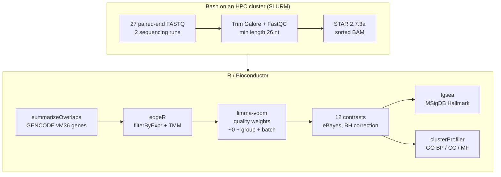

<a href="https://chuabrandon26.github.io/Bulk-RNA-Sequencing-of-MYORG-mutant-astrocytes-in-PFBC/">
  <picture>
    <source media="(prefers-color-scheme: dark)" srcset="docs/assets/visual-abstract-dark.svg">
    
  </picture>
</a>

<h1 align="center">MYORG-deficient astrocytes in primary familial brain calcification</h1>

<p align="center">
  Bulk RNA-seq of primary mouse astrocytes · wild-type vs <i>Myorg</i><sup>−/−</sup> · cortex vs cerebellum · with vs without serum
</p>

<p align="center">
  
  
  
  
  
</p>

<p align="center">
  <b><a href="https://chuabrandon26.github.io/Bulk-RNA-Sequencing-of-MYORG-mutant-astrocytes-in-PFBC/">Open the interactive explorer</a></b>
  &nbsp;·&nbsp; <a href="#the-question">Question</a>
  &nbsp;·&nbsp; <a href="#experimental-design">Design</a>
  &nbsp;·&nbsp; <a href="#workflow">Workflow</a>
  &nbsp;·&nbsp; <a href="#key-findings">Findings</a>
  &nbsp;·&nbsp; <a href="#repository-layout">Scripts</a>
</p>

---

## At a glance

| **27** | **8** | **2** | **12** | **50** |
|:---:|:---:|:---:|:---:|:---:|
| paired-end RNA-seq libraries | groups (genotype × region × medium) | sequencing runs, modeled as a covariate | limma-voom contrasts | MSigDB Hallmark gene sets tested |

> **Take-home:** without *Myorg*, serum-starved astrocytes turn on **NF-κB inflammatory signaling**, while **cell-death and mitochondrial energy programs** move in opposite directions in cortex and cerebellum. One mutation produces region-specific astrocyte responses.

## The question

**Primary familial brain calcification (PFBC)** is a rare neurodegenerative disorder in which calcium phosphate builds up in the basal ganglia, thalamus and cerebellum, often around small blood vessels. Patients can develop movement disorders, psychiatric symptoms and cognitive decline.

Biallelic loss-of-function mutations in **MYORG** cause the autosomal-recessive form of PFBC. MYORG encodes a glycosidase in the endoplasmic reticulum, and in the brain it is made by **astrocytes**. That makes astrocytes the obvious place to look for what goes wrong.

This project asks: **what changes inside astrocytes that lack *Myorg*, and does it depend on brain region and on the cells' environment?** To answer it, the pipeline combines differential expression modeling, pathway-level enrichment and functional ontology analysis.

## Experimental design

Primary astrocytes were cultured from the **cortex (Cx)** and **cerebellum (CB)** of **wild-type (WT)** and ***Myorg*-knockout (HOM)** mice, in **serum-containing (SCM)** or **serum-free (SFM)** medium. Serum pushes cultured astrocytes toward a reactive, injury-like state, while serum-free medium keeps them closer to how they behave in the brain, so the medium is a stress/environment axis.

|  | **Cortex · SCM** | **Cortex · SFM** | **Cerebellum · SCM** | **Cerebellum · SFM** |
|---|:---:|:---:|:---:|:---:|
| **WT** | `SCM_Cx_WT` | `SFM_Cx_WT` | `SCM_CB_WT` | `SFM_CB_WT` |
| **HOM** (*Myorg*<sup>−/−</sup>) | `SCM_Cx_HOM` | `SFM_Cx_HOM` | `SCM_CB_HOM` | `SFM_CB_HOM` |

- **Libraries:** 27 paired-end libraries from two sequencing runs: 18 strand-specific eukaryotic mRNA-seq (`CN274-001U…`) and 9 low-input mRNA-seq (`CN274-002T…`). The run is included as a `batch` term in the model.
- **Reference:** *Mus musculus*, GENCODE vM36 gene annotation.
- **Quality control:** multidimensional scaling (MDS) of voom-transformed expression to check clustering by genotype, region and medium before modeling.

<details>
<summary><b>The 12 contrasts</b> (click to expand)</summary>

<br>

A positive log<sub>2</sub> fold change means higher in the first group.

| # | Contrast | Compares | Factor that changes |
|:-:|---|---|---|
| 1 | `WT_SFM_vs_WT_SCM_Cx` | `SFM_Cx_WT − SCM_Cx_WT` | medium |
| 2 | `HOM_SFM_vs_WT_SFM_Cx` | `SFM_Cx_HOM − SFM_Cx_WT` | genotype |
| 3 | `HOM_SFM_vs_HOM_SCM_Cx` | `SFM_Cx_HOM − SCM_Cx_HOM` | medium |
| 4 | `HOM_SCM_vs_WT_SFM_Cx` | `SCM_Cx_HOM − SFM_Cx_WT` | genotype + medium |
| 5 | `HOM_SCM_vs_WT_SCM_Cx` | `SCM_Cx_HOM − SCM_Cx_WT` | genotype |
| 6 | `WT_SFM_vs_WT_SCM_CB` | `SFM_CB_WT − SCM_CB_WT` | medium |
| 7 | `HOM_SFM_vs_WT_SFM_CB` | `SFM_CB_HOM − SFM_CB_WT` | genotype |
| 8 | `HOM_SFM_vs_HOM_SCM_CB` | `SFM_CB_HOM − SCM_CB_HOM` | medium |
| 9 | `HOM_SCM_vs_WT_SFM_CB` | `SCM_CB_HOM − SFM_CB_WT` | genotype + medium |
| 10 | `HOM_SCM_vs_WT_SCM_CB` | `SCM_CB_HOM − SCM_CB_WT` | genotype |
| 11 | `WT_SFM_Cx_vs_WT_SFM_CB` | `SFM_Cx_WT − SFM_CB_WT` | region |
| 12 | `WT_SCM_Cx_vs_WT_SCM_CB` | `SCM_Cx_WT − SCM_CB_WT` | region |

</details>

## Workflow



<details>
<summary><b>Methods in detail</b> (click to expand)</summary>

<br>

**Preprocessing and alignment**
- Adapter and quality trimming with **Trim Galore** (`--paired --length 26 --phred33`), with **FastQC** on the trimmed reads.
- Spliced alignment with **STAR 2.7.3a** to a mouse genome index, writing coordinate-sorted BAM files (SLURM jobs, 8 threads).
- Gene-level counts with **GenomicAlignments::summarizeOverlaps** (Union mode) on exons grouped by gene from the GENCODE vM36 GTF; Ensembl IDs mapped to symbols with `org.Mm.eg.db`.

**Differential expression (limma-voom)**
- Lowly expressed genes removed with `filterByExpr`; library sizes normalized with trimmed mean of M-values (TMM) in **edgeR**.
- `voomWithQualityWeights` models the mean-variance trend and down-weights noisier samples.
- Design `~ 0 + group + batch`, then `lmFit`, `contrasts.fit` and empirical Bayes moderation (`eBayes`); p-values adjusted with Benjamini-Hochberg.

**Enrichment**

| Approach | Tool | Input | Settings |
|---|---|---|---|
| Differential expression | limma-voom | raw counts | log fold changes and BH-adjusted p-values per contrast |
| Gene set enrichment (GSEA) | `fgsea` | all expressed genes, ranked by $\mathrm{sign}(\log_2 FC) \times -\log_{10}(p)$ | MSigDB mouse Hallmark (`mh.all.v2024.1`), `minSize = 10`, padj < 0.05 |
| Gene Ontology over-representation | `clusterProfiler::enrichGO` | significant up- and down-regulated genes, separately (Entrez IDs via `biomaRt`) | BP, CC and MF; Bonferroni, p and q < 0.05 |

GSEA needs no arbitrary DEG cut-off and picks up coordinated, pathway-wide shifts. GO over-representation describes what the significant genes have in common.

</details>

## Key findings

Hallmark GSEA (fgsea, adjusted p < 0.05) for *Myorg*<sup>−/−</sup> (HOM) astrocytes in serum-free medium:

| Hallmark gene set | Cortex | Cerebellum |
|---|:---:|:---:|
| `HALLMARK_APOPTOSIS` | ▼ down | ▲ up |
| `HALLMARK_OXIDATIVE_PHOSPHORYLATION` | ▼ down | ▲ up |
| `HALLMARK_TNFA_SIGNALING_VIA_NFKB` | ▲ up | ▲ up |

- **Apoptosis and oxidative phosphorylation** are strongly downregulated in HOM SFM cortex but upregulated in HOM SFM cerebellum. The same mutation pushes cell-death and energy-metabolism programs in opposite directions depending on brain region.
- **TNFα signaling via NF-κB** is consistently activated in serum-free conditions, linking MYORG dysfunction to a maladaptive inflammatory state.

Together these point to condition-dependent rewiring of astrocyte gene regulation, with inflammation as a shared response and cell death and metabolism as region-specific ones.

## Repository layout

| Step | Script | What it does |
|---|---|---|
| Trim + QC | [`Trim_galore_Eukaryotic_RNA_sequencing_script_after_edit.sh`](Trim_galore_Eukaryotic_RNA_sequencing_script_after_edit.sh) | Trim Galore + FastQC, run 1 (18 libraries) |
| Trim + QC | [`Trim_galore_low_input_RNA_sequencing_script_after_edit.sh`](Trim_galore_low_input_RNA_sequencing_script_after_edit.sh) | Trim Galore + FastQC, run 2 (9 low-input libraries) |
| Align | [`star_alignment_Eukaryotic_RNA_sequencing_script.sh`](star_alignment_Eukaryotic_RNA_sequencing_script.sh) | STAR alignment, run 1 (SLURM job) |
| Align | [`star_alignment_low_input_RNA_sequencing_script.sh`](star_alignment_low_input_RNA_sequencing_script.sh) | STAR alignment, run 2 (SLURM job) |
| Count → model | [`Combined_data_R_script.R`](Combined_data_R_script.R) | Counting, edgeR/TMM, limma-voom, MDS plots, 12 contrasts, DEG tables |
| GSEA | [`brandon_gsea.R`](brandon_gsea.R) | fgsea on Hallmark sets, per-contrast and combined NES dot plots |
| GO | [`clusterprofiler_brandon.R`](clusterprofiler_brandon.R) | GO enrichment (BP/CC/MF) for up- and down-regulated genes, summary table |
| Visuals | [`docs/`](docs/) | Interactive explorer ([`index.html`](docs/index.html)) and the visual abstract ([`make_visual_abstract.py`](docs/assets/make_visual_abstract.py) rebuilds both SVGs) |

## Condensed analysis script

The core R logic in one place: loading BAM files into a count matrix, filtering and TMM normalization, limma-voom modeling, GSEA and GO enrichment.

<details>
<summary><b>Show the R script</b> (click to expand)</summary>


```R
# ----------------------------
# 0) Imports + Setup
# ----------------------------
require("GenomicAlignments")
require("BiocParallel")
require("GenomicFeatures")
require("Rsamtools")
library(dplyr)
library(org.Mm.eg.db)
library(edgeR)
library(ggplot2)
library(readxl)
library(writexl)
library(fgsea)
library(msigdbr)
library(Glimma)
library(biomaRt)
library(clusterProfiler)
library(enrichplot)

setwd("C:/Users/chuab/Desktop/DEG_Lab_Rotation/Combined_data/Combined_Aligned_Samples")
device_cores <- 4 # Adjust based on parallelization needs

# ----------------------------
# 1) Load Genome Annotations & Targets
# ----------------------------
gtf_file <- "C:/Users/chuab/Desktop/DEG_Lab_Rotation/Lab_Rotation_scripts/gencode.vM36.annotation/gencode.vM36.annotation.gtf"
txdb <- txdbmaker::makeTxDbFromGFF(gtf_file, format="gtf")
ebg <- exonsBy(txdb, by="gene")

targets <- read.delim("C:/Users/chuab/Desktop/DEG_Lab_Rotation/Lab_Rotation_scripts/Gene_Expression_annotation_R_script/Combined_data_target.txt")
targets$batch <- as.factor(targets$batch)
targets$SampleName <- trimws(sub("#.*", "", targets$SampleName))
targets$Factor <- sub("#.*", "", targets$Factor)

group <- targets$Factor
SampleID <- targets$SampleID
design <- model.matrix(~ 0 + group + batch, data = targets)
colnames(design) <- gsub("group", "", colnames(design))

# ----------------------------
# 2) Read BAMs & Summarize Overlaps
# ----------------------------
bam_files <- paste(targets$FileName)
base_sample_names <- sub("^Unknown_", "", sub("_good_Aligned.sortedByCoord.out.bam", "", targets$FileName))
names(bam_files) <- base_sample_names
bam_files <- trimws(bam_files)
bam_files <- bam_files[match(targets$SampleName, names(bam_files))]

bamfiles <- BamFileList(bam_files, yieldSize=2000000)
register(SnowParam(device_cores))

se <- summarizeOverlaps(features = ebg, 
                        reads = bamfiles, 
                        mode = "Union", 
                        singleEnd = TRUE, 
                        ignore.strand = TRUE, 
                        fragments = FALSE)

countTab <- assay(se)
woVersion <- sapply(rownames(countTab), function(x) unlist(strsplit(x, "[.]"))[1])
rownames(countTab) <- as.character(woVersion)

# ----------------------------
# 3) Filter, Normalize (TMM), and Map Gene IDs
# ----------------------------
ensembl_ids <- rownames(countTab)
gene.ids <- mapIds(org.Mm.eg.db, keys = ensembl_ids, keytype = "ENSEMBL", column = "SYMBOL")
gene_list <- data.frame(ENSEMBL=rownames(countTab), SYMBOL=gene.ids)

countMatrix <- countTab[, sapply(as.data.frame(countTab), is.numeric)]
colnames(countMatrix) <- sub("_S.*", "", colnames(countMatrix))

x <- DGEList(counts = countMatrix, group = c(targets$Factor), genes = gene_list)
keep.exprs <- filterByExpr(x, group=targets$Factor)
x.filtered <- x[keep.exprs, keep.lib.sizes=FALSE]
x.filtered <- calcNormFactors(x.filtered)

# ----------------------------
# 4) limma-voom Differential Expression
# ----------------------------
v <- voomWithQualityWeights(x.filtered, design, plot=T)

# Save MDS Plot
jpeg(file= "Myorg_bulk_MDS_plot_Factor.jpeg", width = 4000, height = 3500, res = 300)
plotMDS(v, labels = as.character(group), col = as.numeric(as.factor(group)), cex = 1.5)
dev.off()

cont.matrix_2 <- makeContrasts(
  WT_SFM_vs_WT_SCM_Cx = SFM_Cx_WT - SCM_Cx_WT,
  HOM_SFM_vs_WT_SFM_Cx = SFM_Cx_HOM - SFM_Cx_WT,
  HOM_SFM_vs_HOM_SCM_Cx = SFM_Cx_HOM - SCM_Cx_HOM,
  HOM_SCM_vs_WT_SFM_Cx = SCM_Cx_HOM - SFM_Cx_WT,
  HOM_SCM_vs_WT_SCM_Cx = SCM_Cx_HOM - SCM_Cx_WT,
  WT_SFM_vs_WT_SCM_CB = SFM_CB_WT - SCM_CB_WT,
  HOM_SFM_vs_WT_SFM_CB = SFM_CB_HOM - SCM_CB_HOM,
  HOM_SFM_vs_HOM_SCM_CB = SFM_CB_HOM - SCM_CB_HOM,
  HOM_SCM_vs_WT_SFM_CB = SCM_CB_HOM - SFM_CB_WT,
  HOM_SCM_vs_WT_SCM_CB = SCM_CB_HOM - SCM_CB_WT,
  WT_SFM_Cx_vs_WT_SFM_CB = SFM_Cx_WT - SFM_CB_WT,
  WT_SCM_Cx_vs_WT_SCM_CB = SFM_Cx_WT - SCM_CB_WT,
  levels=design
)

fit <- lmFit(v)
fit2 <- contrasts.fit(fit, cont.matrix_2)
fit2 <- eBayes(fit2)
results <- decideTests(fit2, p.value=0.05, method = "global")
sum.res <- summary(results)

output_dir <- "C:/Users/chuab/Desktop/DEG_Lab_Rotation/Combined_data/Sequenced_data"
dir.create(output_dir, showWarnings=FALSE)

all_com_ls <- colnames(cont.matrix_2)
for (i in seq_along(all_com_ls)) {
  # Save all DEGs
  file_path <- file.path(output_dir, paste0(all_com_ls[i], '.xlsx'))
  deg_table <- topTable(fit2, coef=i, number=nrow(fit2), adjust.method="BH", p.value=1)
  write_xlsx(deg_table, file_path)
  
  # Save significant DEGs (p < 0.05)
  num_sig <- sum.res[1, i] + sum.res[3, i]
  file_path_sig <- file.path(output_dir, paste0('Sig_', all_com_ls[i], '.xlsx'))
  sig_table <- topTable(fit2, coef=i, number=num_sig, adjust.method="BH", p.value=0.05)
  write_xlsx(sig_table, file_path_sig)
}

# ----------------------------
# 5) Gene Set Enrichment Analysis (GSEA)
# ----------------------------
gmt.file <- "C:/Users/chuab/Desktop/DEG_Lab_Rotation/Lab_Rotation_scripts/GSEA_R_script/mh.all.v2024.1.Mm.symbols.gmt"
pathways <- gmtPathways(gmt.file)

for (current_file in paste0(all_com_ls, ".xlsx")) {
  current_marker_expr_df <- readxl::read_xlsx(file.path(output_dir, current_file)) %>%
    group_by(SYMBOL) %>%
    filter(AveExpr == max(AveExpr, na.rm = TRUE)) %>%
    ungroup() %>% filter(!is.na(SYMBOL))
  
  # Calculate ranking metric: sign(logFC) * -log10(p-value)
  current_marker_expr_df$comb_val <- sign(current_marker_expr_df$logFC) * -log10(current_marker_expr_df$P.Value)
  ranks <- current_marker_expr_df$comb_val
  names(ranks) <- current_marker_expr_df$SYMBOL
  ranks <- ranks[!(is.infinite(ranks) | is.na(ranks))]
  
  set.seed(42)
  fgseaRes <- fgsea::fgsea(pathways, ranks, minSize = 10, maxSize = Inf, scoreType = "std", nproc = 1)
  gsea_sig <- fgseaRes[fgseaRes$padj < 0.05,]
  
  # Save and plot
  current_file_filtered <- gsub(".xlsx", "", current_file)
  gsea_sig_df <- gsea_sig[, c("pathway", "NES", "pval", "padj", "size")]
  write.csv(gsea_sig_df, paste0("GSEA_results_", current_file_filtered, ".csv"), row.names = FALSE)
  
  gsea_plot <- ggplot(gsea_sig, aes(x = NES, y = pathway, color = pval, size = size)) + 
    geom_point(stat = 'identity') + theme_bw() + ggtitle(paste0("GSEA on ", current_file_filtered))
  ggsave(paste0("GSEA_hallmark_", current_file_filtered, ".png"), plot = gsea_plot, width = 26, height = 10)
}

# ----------------------------
# 6) Gene Ontology (GO) Enrichment (clusterProfiler)
# ----------------------------
ensembl <- useMart("ensembl", dataset = "mmusculus_gene_ensembl")

find_go_terms <- function(gene_list){
  gene_ids <- getBM(attributes = c('mgi_symbol', 'entrezgene_id'), filters = 'mgi_symbol', values = gene_list, mart = ensembl)
  go_enrichment <- enrichGO(gene = unique(gene_ids$entrezgene_id), OrgDb = org.Mm.eg.db, ont = "ALL", 
                            pAdjustMethod = "bonferroni", pvalueCutoff = 0.05, qvalueCutoff = 0.05, readable = TRUE)
  return(list(go_enrichment = go_enrichment, gene_ids = gene_ids))
}

# Example wrapper for one contrast
current_marker_expr_df <- readxl::read_xlsx(file.path(output_dir, "Sig_WT_SFM_Cx_vs_WT_SFM_CB.xlsx"))
negative_genes <- current_marker_expr_df[current_marker_expr_df$logFC < 0,]
positive_genes <- current_marker_expr_df[current_marker_expr_df$logFC > 0,]

for (ont_type in c('BP', 'CC', 'MF')) {
  if (nrow(positive_genes) > 0) {
    results_pos <- find_go_terms(positive_genes$SYMBOL)
    sag_pos <- data.frame(results_pos$go_enrichment)
    res_df_pos <- sag_pos[sag_pos$p.adjust < 0.05 & sag_pos$ONTOLOGY == ont_type, ]
    write.csv(res_df_pos, paste0('Clusterprofiler_GO_', ont_type, '_pos.csv'), row.names = FALSE)
  }
  if (nrow(negative_genes) > 0) {
    results_neg <- find_go_terms(negative_genes$SYMBOL)
    sag_neg <- data.frame(results_neg$go_enrichment)
    res_df_neg <- sag_neg[sag_neg$p.adjust < 0.05 & sag_neg$ONTOLOGY == ont_type, ]
    write.csv(res_df_neg, paste0('Clusterprofiler_GO_', ont_type, '_neg.csv'), row.names = FALSE)
  }
}
```

</details>

## License

Released under the [MIT License](LICENSE).
